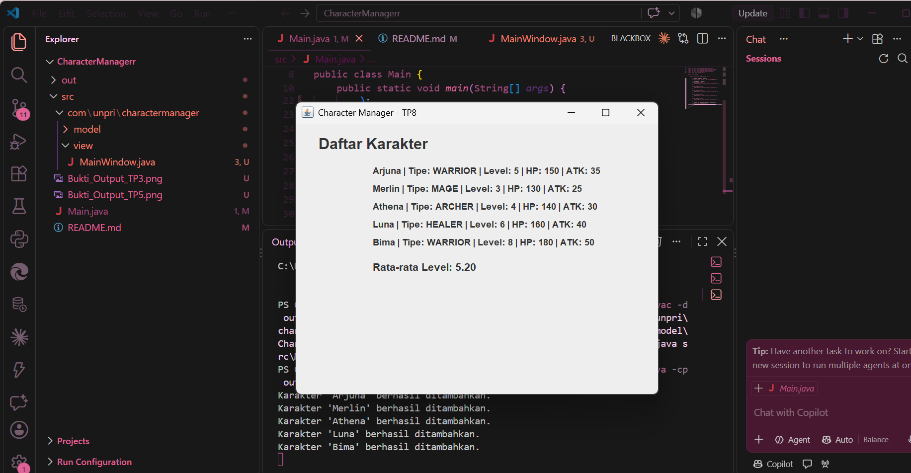
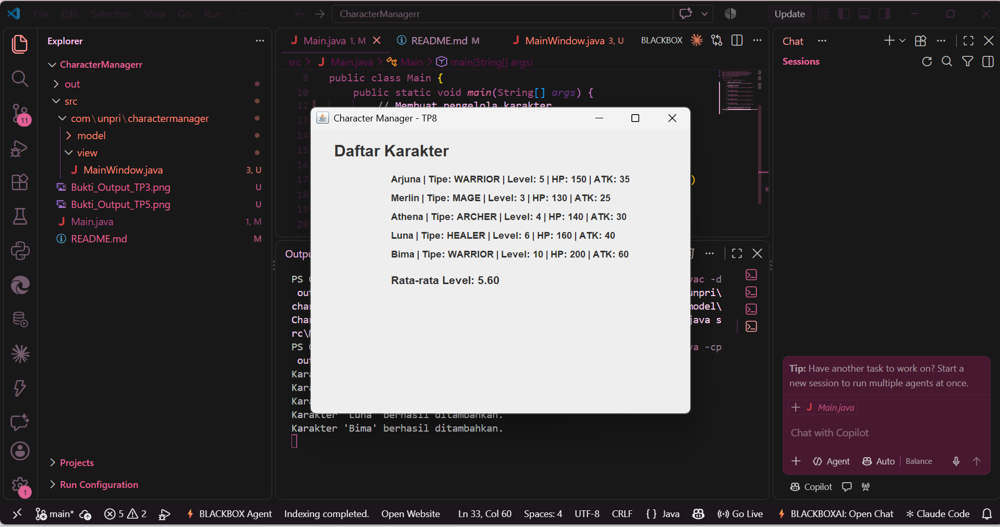

# Character Manager — TP8

## 1. Deskripsi

Character Manager merupakan aplikasi Java sederhana untuk mengelola dan menampilkan data karakter game menggunakan Java Swing. Pada TP8, aplikasi dikembangkan dengan menambahkan tampilan GUI menggunakan `JFrame`, menampilkan data karakter secara dinamis, serta menghitung rata-rata level karakter.

## 2. Tujuan

- Memahami pembuatan GUI menggunakan Java Swing.
- Mengimplementasikan `JFrame`, `JPanel`, dan `JLabel`.
- Menampilkan data karakter menggunakan perulangan.
- Memahami penggunaan `SwingUtilities.invokeLater()`.
- Mengimplementasikan konsep MVC dalam aplikasi Java.

## 3. Struktur Project

```text
CharacterManager
├── src
│   ├── Main.java
│   └── com
│       └── unpri
│           └── charactermanager
│               ├── model
│               │   ├── Character.java
│               │   ├── CharacterType.java
│               │   └── CharacterManager.java
│               └── view
│                   └── MainWindow.java
├── out
└── README.md
```

## 4. Implementasi Program

### MainWindow

`MainWindow` merupakan bagian View yang bertanggung jawab menampilkan data karakter dalam jendela Java Swing. Data karakter diterima melalui constructor dari `Main.java`.

Data karakter ditampilkan menggunakan perulangan `for`, sehingga jumlah karakter yang ditampilkan mengikuti data yang diberikan. Program juga menampilkan rata-rata level karakter menggunakan `JLabel`.

### Main.java

`Main.java` merupakan titik awal program. Pada bagian ini, objek `CharacterManager` dibuat dan digunakan untuk menambahkan data karakter.

GUI dijalankan menggunakan `SwingUtilities.invokeLater()` agar pembuatan tampilan dilakukan pada Event Dispatch Thread (EDT).

## 5. Data Karakter

Program menampilkan lima karakter:

| Nama | Tipe | Level |
|---|---|---:|
| Arjuna | WARRIOR | 5 |
| Merlin | MAGE | 3 |
| Athena | ARCHER | 4 |
| Luna | HEALER | 6 |
| Bima | WARRIOR | 8 |

Rata-rata level karakter adalah:

\[
\frac{5+3+4+6+8}{5}=5.20
\]

## 6. Analisis MVC

Aplikasi menerapkan konsep Model-View dengan pemisahan tanggung jawab:

- **Model:** `Character`, `CharacterType`, dan `CharacterManager` mengelola data serta logika karakter.
- **View:** `MainWindow` menampilkan data karakter dalam bentuk GUI.
- **Main:** Menginisialisasi data dan menghubungkan `CharacterManager` dengan `MainWindow`.

Pemisahan ini membuat program lebih terstruktur dan memudahkan pengembangan fitur berikutnya.

## 7. Bukti Program

### Screenshot 1 — Tampilan dengan Lima Karakter



### Screenshot 2 — Perubahan Data Karakter



## 8. Kesimpulan

Melalui TP8, aplikasi Character Manager berhasil dikembangkan menjadi aplikasi desktop menggunakan Java Swing. Data karakter ditampilkan secara dinamis melalui perulangan, rata-rata level dihitung berdasarkan data yang tersedia, dan GUI dijalankan menggunakan `SwingUtilities.invokeLater()`. Implementasi ini membantu memahami dasar pengembangan GUI serta pemisahan Model dan View dalam konsep MVC.

## 9. Dokumen Google Docs

Dokumen Google Docs berisi penjelasan teori dan analisis mengenai Java Swing, program sequential dan event-driven, penggunaan `SwingUtilities.invokeLater()`, konsep inheritance dan komposisi, serta penerapan MVC pada aplikasi Character Manager.

https://docs.google.com/document/d/1kIS5dgznQwIm7O-5p7fOIhc0tNEwpKesG9T6N37T1bE/edit?usp=sharing