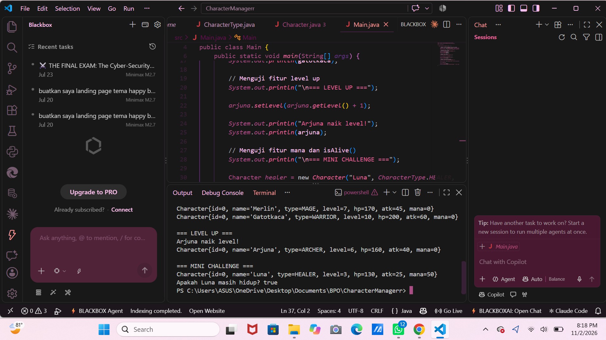

# Character Manager — TP3 (Java Visual SIH-6406)

## 1. Deskripsi

Character Manager merupakan aplikasi Java sederhana untuk mengelola dan menampilkan data karakter game. Project ini dibuat untuk memenuhi tugas TP3 mata kuliah Java Visual SIH-6406.

Aplikasi ini menerapkan konsep Object-Oriented Programming (OOP), seperti class, object, constructor, encapsulation, getter, setter, dan enum. Program juga memiliki fitur level up, pengaturan mana, serta pengecekan status hidup karakter.

## 2. Fitur Program

- Membuat karakter menggunakan constructor.
- Menampilkan data karakter.
- Menggunakan enum `CharacterType` untuk jenis karakter.
- Mengatur level karakter.
- Menghitung HP dan attack berdasarkan level.
- Mengatur mana dengan validasi.
- Mengecek status hidup menggunakan `isAlive()`.
- Menampilkan data karakter melalui method `toString()`.

## 3. Struktur Project

```text
CharacterManagerr
├── src
│   ├── Main.java
│   └── com
│       └── unpri
│           └── charactermanager
│               └── model
│                   ├── Character.java
│                   └── CharacterType.java
├── out
└── README.md
```

## 4. Cara Menjalankan Program

Compile program:

```powershell
javac -d out src\com\unpri\charactermanager\model\CharacterType.java src\com\unpri\charactermanager\model\Character.java src\Main.java
```

Jalankan program:

```powershell
java -cp out Main
```

## 5. Bukti Program

Screenshot hasil output program:



Screenshot menunjukkan program berhasil menampilkan tiga karakter, melakukan level up pada Arjuna, mengatur mana Luna, dan menjalankan method `isAlive()` dengan hasil `true`.

## 6. Identitas

- Nama: Chelsi Valentine Harefa
- NIM: 253303621254
- Mata Kuliah: Java Visual SIH-6406
- Tugas: TP3 — Character Manager Sprint #1

## 7. Link Google Docs

https://docs.google.com/document/d/1GbjOBjqaqCjnWuIgEAI1WUFzneOqaH9qc4DoRaXp3_E/edit?usp=sharing